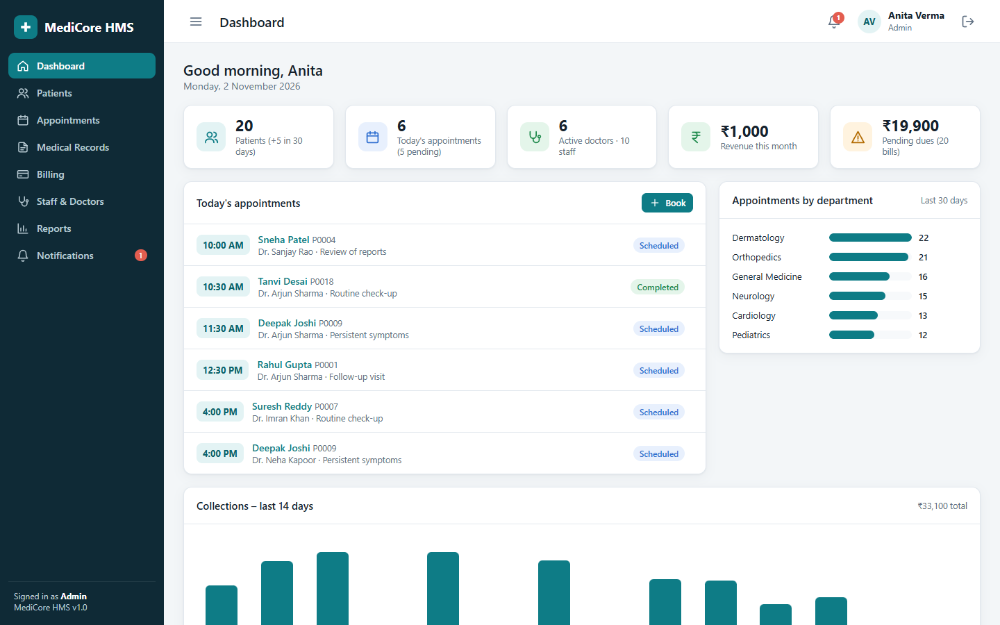
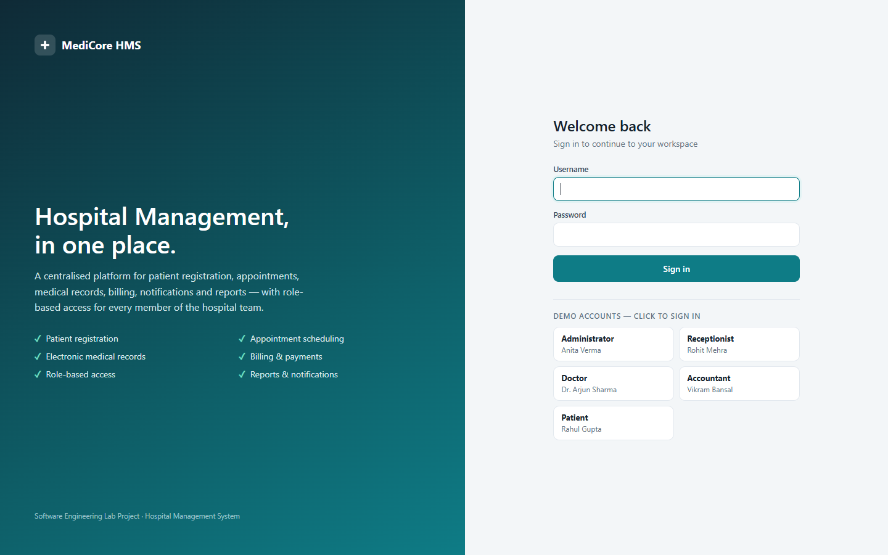
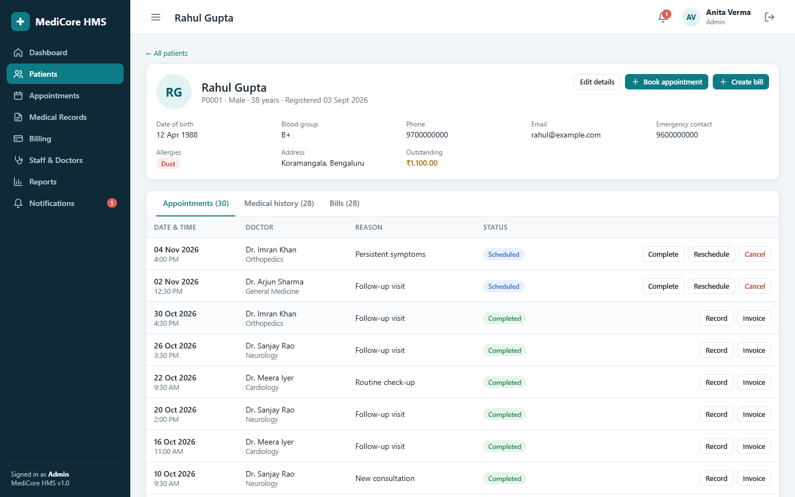
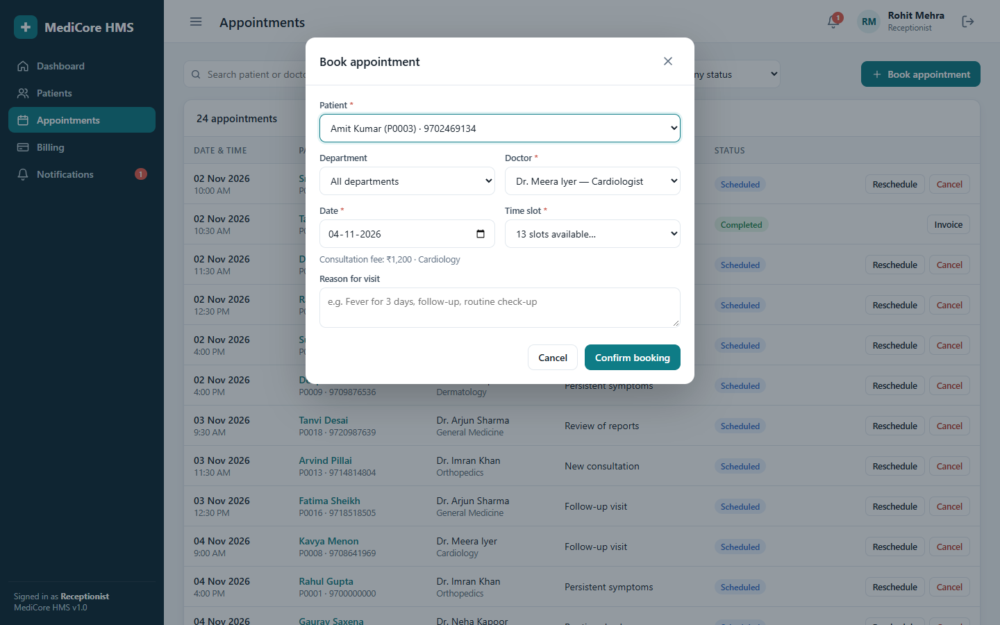
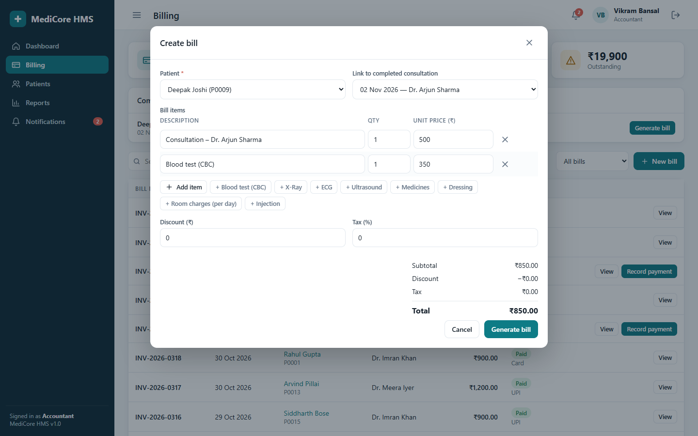
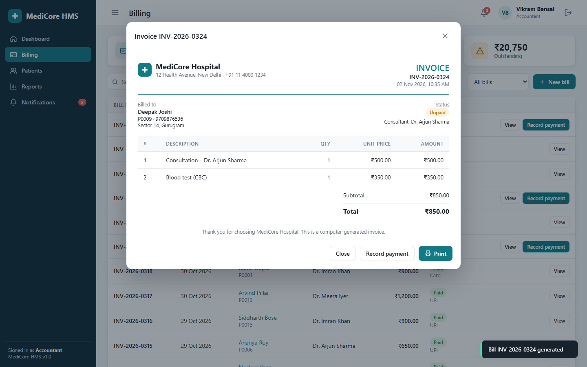
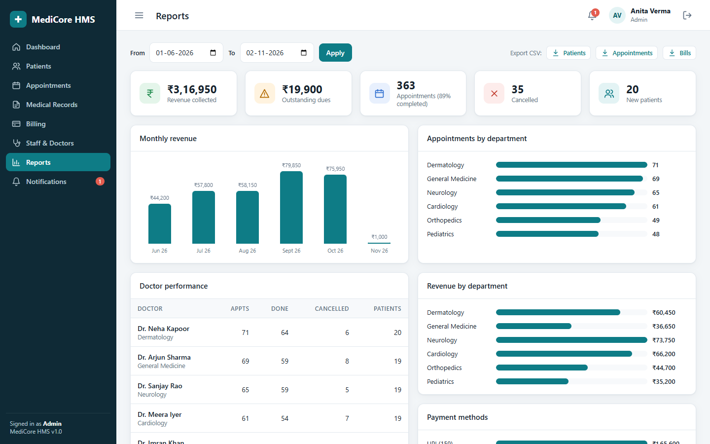
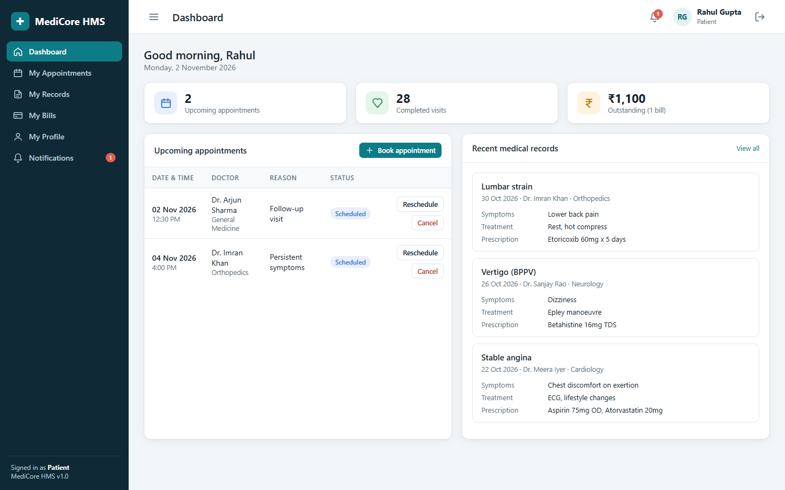

<div align="center">

# 🏥 MediCore HMS

**A full-stack Hospital Management System**: patient registration, appointment scheduling, electronic medical records, billing, notifications and reports, all with role-based access control.


*Software Engineering Lab Project*



</div>

---

## 📋 Table of contents

- [About](#-about)
- [Features](#-features)
- [Screenshots](#-screenshots)
- [Quick start](#-quick-start)
- [Demo accounts](#-demo-accounts)
- [Role permissions](#-role-permissions)
- [Requirement traceability](#-requirement-traceability)
- [Architecture](#-architecture)
- [Database schema](#-database-schema)
- [REST API](#-rest-api)
- [Project structure](#-project-structure)
- [Demo walkthrough](#-demo-walkthrough)
- [Team](#-team)

---

## 📖 About

Hospitals that depend on registers and disconnected files run into duplicate data entry, records that are hard to find, appointment clashes and billing delays. **MediCore HMS** puts these activities in one system. Each authorised user can record, retrieve and update hospital information according to their role.

The system implements the requirements in our project report ([`docs/project-report.pdf`](docs/project-report.pdf)), which covers the Initialization and Planning phases: problem identification, objectives, stakeholders, scope, use-case and activity diagrams, requirements, schedule and risk analysis.

## ✨ Features

| Module | What it does |
|---|---|
| 🔐 **Authentication** | Secure login and logout, scrypt-hashed passwords, HttpOnly session cookies, self-service password change |
| 🧑‍🤝‍🧑 **Patients** | Register, edit, search and view full profiles; auto-generated patient IDs (`P0001`…); duplicate detection; allergy flags |
| 📅 **Appointments** | Book, reschedule, cancel and complete; a free-slot picker per doctor and date; prevents double-booking of both doctor and patient; closed on Sundays and during lunch |
| 🩺 **Medical records** | Doctors record symptoms, diagnosis, treatment and prescription from a "Consult" action; full visit history; allergy warning when writing a record |
| 💳 **Billing** | Itemised bills with discount and tax; consultation fee auto-filled from the appointment; list of completed consultations still awaiting a bill; payments by Cash, UPI, Card or Insurance; printable invoice |
| 🔔 **Notifications** | Real-time bell and inbox; automatic alerts when appointments are booked, rescheduled or cancelled, when records are added, and when bills are generated or paid |
| 📊 **Reports** | Revenue trends, department load and revenue, doctor performance, payment-method split, top diagnoses, date-range filter, **CSV export** |
| 👥 **Staff management** | Admin creates, edits and deactivates staff accounts; manages departments, specialisations and consultation fees |
| 🛡️ **Access control** | Role-specific menus and dashboards; **every API call is authorised on the server** |

## 📸 Screenshots

| Login | Patient profile |
|---|---|
|  |  |
| **Book appointment (free-slot picker)** | **Create bill** |
|  |  |
| **Printable invoice** | **Reports** |
|  |  |
| **Patient portal** | |
|  | |

## 🚀 Quick start

**Prerequisite:** [Node.js](https://nodejs.org/) **22.5 or newer**. The app uses Node's built-in `node:sqlite`, so no database server or native build tools are needed.

```bash
git clone https://github.com/Krsh-hub/hospital-management-system.git
cd hospital-management-system/app
npm install
npm start
```

Open **http://localhost:3000** for the landing page; the app itself is at **http://localhost:3000/app**.

On the first run, the database (`app/data/hms.db`) is created automatically and filled with about 5 months of realistic demo data: 20 patients, 6 doctors in 6 departments, about 360 appointments, plus the records and bills that go with them.

| Command | Description |
|---|---|
| `npm start` | Start the server on port 3000 (override with `PORT=4000 npm start`) |
| `npm run reset` | Delete the database; fresh demo data, dated around today, is generated on the next start |

**Windows shortcut:** double-click `start.bat` to install, start and open the browser. Double-click `reset-demo-data.bat` to regenerate the data.

> 💡 The demo data is generated relative to the current date. Run `npm run reset` on the day of a demo so that "today's appointments" are filled in.

## 🔑 Demo accounts

The login page has **one-click buttons** for each role.

| Role | Username | Password |
|---|---|---|
| Administrator | `admin` | `admin123` |
| Receptionist | `reception` | `reception123` |
| Doctor | `doctor` | `doctor123` |
| Accountant | `accounts` | `accounts123` |
| Patient | `patient` | `patient123` |

Other doctors (`dr.iyer`, `dr.khan`, `dr.das`, `dr.rao`, `dr.kapoor`) also use `doctor123`.

## 🛡️ Role permissions

| Capability | Admin | Receptionist | Doctor | Accountant | Patient |
|---|:-:|:-:|:-:|:-:|:-:|
| Register / edit patients | ✅ | ✅ | – | – | – |
| View patients | ✅ | ✅ | ✅ | ✅ | own only |
| Book / reschedule appointments | ✅ | ✅ | – | – | own only |
| Cancel appointments | ✅ | ✅ | own | – | own |
| Medical records (view) | ✅ | ❌ | ✅ | ❌ | own only |
| Medical records (write) | – | – | ✅ | – | – |
| Create bills / record payments | ✅ | – | – | ✅ | – |
| View bills | ✅ | ✅ | – | ✅ | own only |
| Reports & CSV export | ✅ | – | – | ✅ | – |
| Staff & departments | ✅ | – | – | – | – |

## ✅ Requirement traceability

| ID | Requirement | Implementation |
|---|---|---|
| FR-01 | User authentication | `POST /api/login`, `/logout`, scrypt hashing, session table |
| FR-02 | Patient management | Patients module, validation, duplicate check |
| FR-03 | Doctor & staff management | Staff & Doctors module (admin) |
| FR-04 | Appointment management | Slot engine plus conflict checks in `checkSlot()` |
| FR-05 | Medical records | Consult flow, patient history tab |
| FR-06 | Billing | Bills and bill items, payments, invoice |
| FR-07 | Notifications | `notifications` table, bell polling, event triggers |
| FR-08 | Reports | `/api/reports`, charts, CSV export |
| FR-09 | Search & retrieval | Search on patients, appointments, records and bills |
| FR-10 | Access control | `auth(...roles)` middleware on every route |
| NFR-01 | Security | Hashed passwords, HttpOnly cookies, server-side authorisation, parameterised SQL |
| NFR-03 | Usability | Consistent responsive UI, inline validation messages |
| NFR-04 | Reliability | DB transactions, foreign keys, WAL journaling |
| NFR-06 | Maintainability | Modular API, single-file schema, no build step |
| NFR-08 | Data integrity | Input validation plus `CHECK` / `UNIQUE` / FK constraints |

## 🏗️ Architecture

```
┌──────────────────────────┐   fetch (JSON)   ┌────────────────────────────┐   SQL   ┌──────────────┐
│  Browser SPA             │ ───────────────▶ │  Express REST API          │ ──────▶ │  SQLite DB   │
│  HTML + CSS + vanilla JS │ ◀─────────────── │  auth(...roles) middleware │ ◀────── │  hms.db      │
│  hash-based routing      │  session cookie  │  validation, notifications │         │              │
└──────────────────────────┘                  └────────────────────────────┘         └──────────────┘
```

- **Backend:** Node.js and Express 4 (`app/server.js`)
- **Database:** SQLite through the built-in `node:sqlite` module (`app/db.js`)
- **Frontend:** a dependency-free single-page app (`app/public/`) that **works fully offline**

## 🗄️ Database schema

```
departments (id, name, description)
users       (id, username, password_hash, salt, name, role, email, phone,
             department_id → departments, specialization, consultation_fee,
             patient_id → patients, active)
patients    (id, uid, name, gender, dob, blood_group, phone, email, address,
             emergency_contact, allergies, created_at)
appointments(id, patient_id → patients, doctor_id → users, date, time, reason,
             status ∈ {Scheduled, Completed, Cancelled}, created_by)
medical_records(id, patient_id, doctor_id, appointment_id, visit_date,
             symptoms, diagnosis, treatment, prescription, notes)
bills       (id, bill_no, patient_id, appointment_id, subtotal, discount,
             tax_percent, total, status ∈ {Unpaid, Paid}, payment_method, paid_at)
bill_items  (id, bill_id → bills, description, qty, unit_price)
notifications(id, user_id → users, title, message, is_read, created_at)
sessions    (token, user_id → users, created_at)
```

## 🔌 REST API

<details>
<summary>Endpoint reference (click to expand)</summary>

| Method | Endpoint | Roles |
|---|---|---|
| POST | `/api/login`, `/api/logout` | public |
| GET | `/api/me` · POST `/api/me/password` | any |
| GET / POST | `/api/departments` | any / admin |
| GET | `/api/doctors` | any |
| GET / POST / PUT | `/api/staff`, `/api/staff/:id` | admin |
| GET | `/api/patients`, `/api/patients/:id` | staff (patient: own) |
| POST / PUT | `/api/patients`, `/api/patients/:id` | admin, receptionist |
| DELETE | `/api/patients/:id` | admin (only when no history) |
| GET | `/api/appointments`, `/api/appointments/slots` | any (scoped) |
| POST | `/api/appointments` | admin, receptionist, patient |
| PUT | `/api/appointments/:id` `{action: reschedule\|cancel\|complete}` | per-action rules |
| GET | `/api/records`, `/api/records/:id` | admin, doctor, patient (own) |
| POST / PUT | `/api/records`, `/api/records/:id` | doctor |
| GET | `/api/bills`, `/api/bills/:id`, `/api/bills/unbilled` | billing roles (scoped) |
| POST | `/api/bills` · PUT `/api/bills/:id/pay` | admin, accountant |
| GET / POST | `/api/notifications`, `/api/notifications/read` | any |
| GET | `/api/dashboard` | any (role-specific) |
| GET | `/api/reports`, `/api/reports/export/:type` | admin, accountant |

</details>

## 📁 Project structure

```
.
├── app/
│   ├── server.js          # Express REST API, auth & role middleware
│   ├── db.js              # Schema, password hashing, demo-data seeder
│   ├── package.json
│   └── public/
│       ├── index.html
│       ├── styles.css
│       └── app.js         # Single-page front-end
├── docs/
│   ├── project-report.pdf # SE Lab report (initialization & planning)
│   └── screenshots/
├── start.bat              # Windows one-click launcher
├── reset-demo-data.bat
└── README.md
```

## 🎬 Demo walkthrough

1. **Receptionist**: register a new patient, then book an appointment with *Dr. Arjun Sharma* for today. Only free slots are offered; try the same slot again to see conflict prevention.
2. **Doctor**: today's schedule is on the dashboard. Click **Consult**, enter the diagnosis and prescription, and save. The appointment is marked *Completed*.
3. **Accountant**: Billing lists consultations awaiting a bill. Click **Generate bill**, add a blood test, then **Record payment** and **Print** the invoice.
4. **Patient**: see your own appointments, records, bills and notifications. Opening another patient's URL (`#/patients/2`) is denied.
5. **Admin**: dashboard KPIs, Reports with CSV export, and Staff & Doctors (add a doctor, deactivate an account).

## 👨‍💻 Team

| Name | Roll No. |
|---|---|
| Supriya Choudhary | 241001001237 |
| Saloni Rani | 241001001239 |
| Swayam Bhalotia | 241001001240 |
| Prince Kumar | 241001001241 |
| Krishnendu Dhar | 241001001243 |

## 📄 License

Released under the [MIT License](LICENSE).
